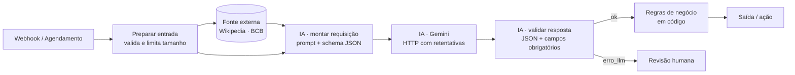

# ⚙️ AI Workflow Automation: 5 automações com n8n + IA

**Cinco workflows prontos para importar no n8n que tiram trabalho manual repetitivo de pequenas empresas: triagem de e-mails, organização de documentos, atas de reunião, pesquisa com fontes e boletim de indicadores. Em todos, a IA interpreta e as regras de negócio decidem.**

| # | Workflow | Entrada | Saída | IA faz | Regra em código decide |
|---|---|---|---|---|---|
| 1 | [Email Intelligence](workflows/01_email_intelligence.json) | e-mail | fila (urgente · normal · arquivar · revisão humana) + rascunho | classifica, resume, extrai valores e prazos, rascunha resposta | spam não recebe resposta; confiança < 0,6 ou cobrança com valor vai para humano |
| 2 | [Document Processing](workflows/02_document_processing.json) | texto do documento | tipo, campos, pasta de destino | classifica e extrai campos | CNPJ fora do formato ou nota sem total vão para revisão |
| 3 | [Meeting Intelligence](workflows/03_meeting_intelligence.json) | transcrição + participantes | ata em Markdown, tarefas com responsável e prazo | resume, separa decisões, tarefas e riscos | tarefa atribuída a quem não estava na reunião vira "a definir" |
| 4 | [Research Automation](workflows/04_research_automation.json) | tema | relatório com citações numeradas | sintetiza **só** a partir das fontes | citação a fonte inexistente é removida e o ponto é marcado |
| 5 | [Data Reporting](workflows/05_data_reporting.json) | agendamento (dias úteis 19h) ou webhook | boletim do dólar | escreve o texto | todo número do texto precisa existir nos dados do BCB |

## Arquitetura comum



Os três nós de IA são idênticos nos 5 fluxos porque **os workflows são gerados** por [`workflows/build.py`](workflows/build.py), com prompts e schemas em [`workflows/prompts.py`](workflows/prompts.py). Mudar o modelo, o tratamento de erro ou o formato da requisição é uma alteração só. Decisões e alternativas avaliadas estão em [`docs/DECISOES.md`](docs/DECISOES.md).

## Como foi testado

[`tests/e2e.py`](tests/e2e.py) sobe o **n8n 2.47.7 real** em Docker, importa e ativa os 5 workflows e chama os webhooks com [entradas de exemplo](samples/). Só o Gemini é substituído por um [servidor falso](mock_llm/server.py) que:

- **valida o formato da requisição** (instrução de sistema, conteúdo, `responseJsonSchema`) e devolve erro 400 se estiver errado;
- confere se cada resposta roteirizada tem os campos obrigatórios do schema;
- simula falhas: JSON inválido e erro 500.

As APIs da **Wikipedia** e do **Banco Central** são chamadas de verdade.

**Resultado** ([`tests/resultados_e2e.json`](tests/resultados_e2e.json)): **11/11 casos aprovados**, incluindo as quatro filas de e-mail, a falha do modelo tratada sem quebrar o fluxo, a citação inventada removida e o boletim com dados reais do BCB.

> Os tempos registrados (0,1 s a 0,8 s por execução) medem só a orquestração no n8n e as APIs públicas. **Não incluem a inferência do LLM**, então não servem como tempo real de execução.

## Status da validação

| Item | Status |
|---|---|
| Importação e ativação no n8n 2.47.7 | ✅ |
| Lógica dos fluxos, regras de negócio, tratamento de erro | ✅ 11 casos de ponta a ponta |
| Integração real com Wikipedia e Banco Central | ✅ |
| Formato da requisição aceito pelo **Gemini real** | ✅ os 5 fluxos rodaram com `gemini-3.5-flash-lite` (status `ok` em todos) |
| Classificações, extrações e resumos do Gemini | ◐ 10 casos com o modelo real (8 pelo critério do e2e, 10 pelas invariantes dos fluxos); ⏳ **pendente**: conjunto rotulado maior e benchmark |
| Integrações de saída (Gmail, Slack, Drive) | ⏳ **pendente**: hoje os nós de ação registram a decisão (`modo: demonstracao`) |

## Validação com o Gemini real

[`tests/e2e_gemini.py`](tests/e2e_gemini.py) roda os mesmos casos do e2e, no n8n real, trocando o servidor falso pelo **Gemini real** (`gemini-3.5-flash-lite`, 16/11/2026). Fica de fora só o caso de "resposta inválida do LLM", que só existe no servidor falso. Saída completa de cada caso em [`tests/resultados_gemini.json`](tests/resultados_gemini.json).

| Fluxo | Casos | Aprovados | Tempo por execução |
|---|---|---|---|
| E-mail | 4 | 4/4 | 1,1 s a 7,6 s |
| Documento | 3 | 3/3 | 1,1 s a 6,0 s |
| Reunião | 1 | 0/1 pelo critério do e2e · **invariante ✓** | 2,1 s |
| Pesquisa | 1 | 0/1 pelo critério do e2e · **invariante ✓** | 2,6 s |
| Boletim (BCB) | 1 | 1/1 | 1,7 s |

Aqui os tempos **incluem** a inferência do modelo (uma execução por caso, sem repetição, então servem só como ordem de grandeza).

**O que valeu a pena nos dois casos "reprovados".** Os critérios do e2e foram escritos para o servidor falso, que é roteirizado para errar de propósito e exercitar as regras em código. Com o modelo real, o que importa é se o fluxo entrega um resultado correto:

- **Reunião:** o e2e espera `tarefas_sem_responsavel == 1` porque o falso atribui uma tarefa a Carlos, que não estava na reunião. O Gemini real não atribuiu a tarefa a ninguém e a registrou como **risco** ("revisão do contrato em aberto sem responsável definido"). Não houve atribuição indevida para a regra corrigir. Ressalva honesta: a tarefa ficou fora da tabela de tarefas, o que é discutível; o ideal seria aparecer como "a definir".
- **Pesquisa:** o e2e espera `citacoes_invalidas == 1` porque o falso inventa a citação `[3]`. O Gemini real citou apenas as 2 fontes existentes (0 citações inválidas, 0 pontos sem fonte).

Por isso os dois números aparecem lado a lado: o critério original reprova esses dois casos e a **invariante** do fluxo (nenhuma tarefa atribuída a quem não participou; nenhuma citação fora das fontes) passa nos dois. Não troquei o critério para forçar 10/10.

O que **não** está validado: a checagem de citações só garante que o número citado existe entre as fontes, não que a frase corresponda ao conteúdo da fonte; e 10 casos de um único modelo não são um benchmark.

### Etapas manuais eliminadas

Sem estimativa de horas economizadas enquanto não houver medição. O que dá para afirmar é quantas etapas deixam de ser manuais:

| Workflow | Etapas manuais hoje | Continua manual |
|---|---|---|
| E-mail | ler, classificar, priorizar, anotar valores e prazos, escrever resposta | revisar os casos enviados para revisão humana e aprovar o rascunho |
| Documento | abrir, identificar o tipo, copiar campos, conferir CNPJ e total, arquivar | revisar os que falham na validação |
| Reunião | reler as anotações, listar decisões e tarefas, montar a ata, cobrar responsáveis | definir o responsável das tarefas "a definir" |
| Pesquisa | buscar, abrir fontes, ler, resumir, montar as referências | conferir os pontos marcados sem fonte |
| Indicador | acessar o site, copiar a série, calcular variações, escrever o boletim | nenhuma (a menos que a checagem de números marque `revisar`) |

## Como usar

```bash
# n8n com os 5 workflows ativos (editor em http://localhost:5678)
GEMINI_API_KEY=... docker compose up -d

curl -X POST localhost:5678/webhook/email-intelligence -H 'Content-Type: application/json' \
     -d @samples/email_reclamacao.json
```

| Webhook | Exemplo |
|---|---|
| `POST /webhook/email-intelligence` | [`samples/email_*.json`](samples/) |
| `POST /webhook/document-processing` | [`samples/doc_*.json`](samples/) |
| `POST /webhook/meeting-intelligence` | [`samples/reuniao.json`](samples/reuniao.json) |
| `POST /webhook/research` | [`samples/pesquisa.json`](samples/pesquisa.json) |
| `POST /webhook/data-report` | `{}` (também roda sozinho em dias úteis às 19h) |

Testes:

```bash
python tests/e2e.py                 # n8n + LLM falso, sem chave e sem custo
python workflows/build.py           # regenera os JSON depois de mudar prompts ou regras
```

Para importar em um n8n existente, use *Import from File* com os arquivos de `workflows/`.

## Limitações

- O processamento de documentos recebe **texto**. A extração de PDF ou imagem (OCR) fica antes do webhook.
- A chave do Gemini é lida por variável de ambiente, e não pelo cofre de credenciais do n8n. A troca está em [`docs/DECISOES.md`](docs/DECISOES.md).
- Os dados de exemplo são fictícios.

## Roadmap

- [ ] Validar com o Gemini e publicar um benchmark com e-mails e documentos rotulados
- [ ] Gmail (gatilho e rótulos), Slack (notificação) e Google Drive (arquivamento) nos nós de ação
- [ ] Migrar a chave para credenciais do n8n

---

Licença MIT. Dados de exemplo fictícios.
